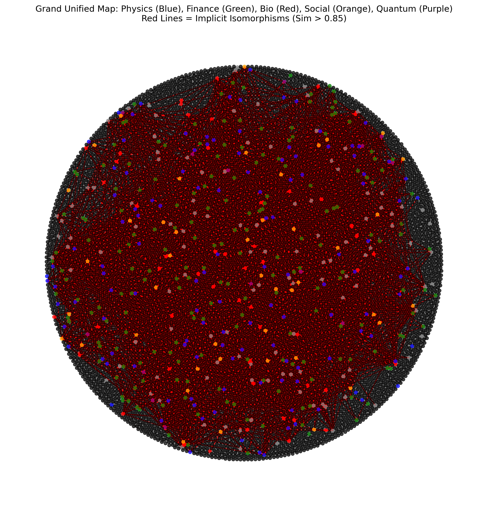
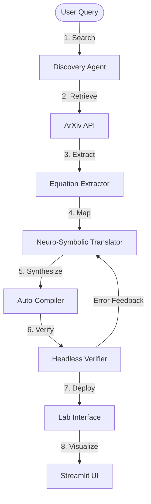
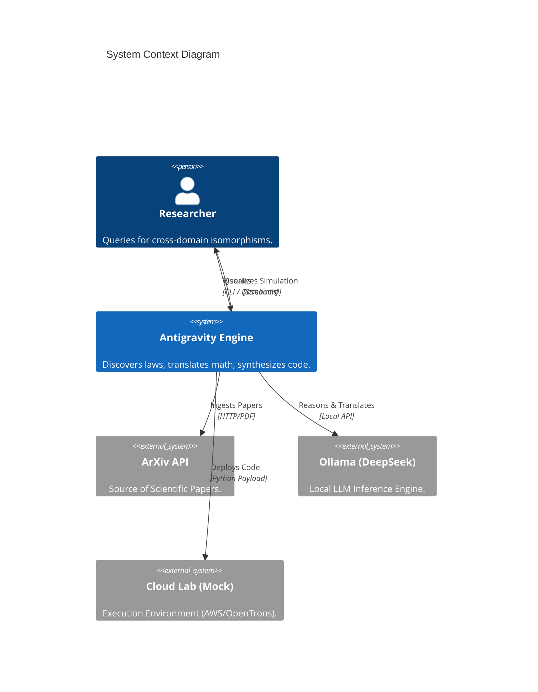
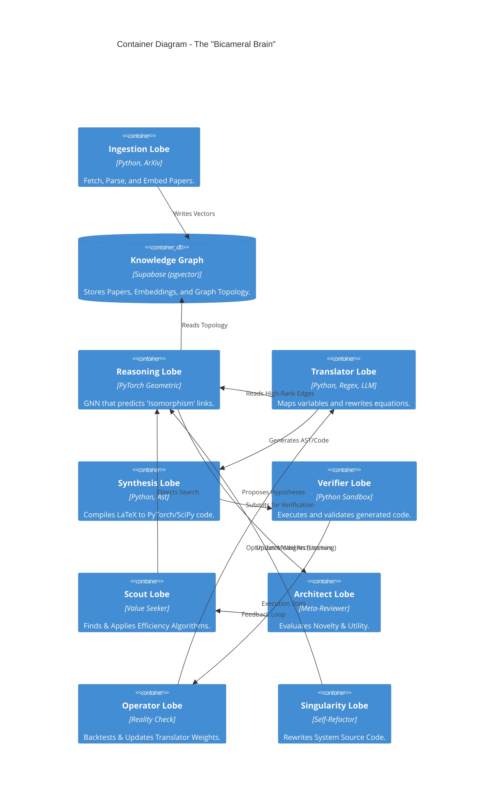
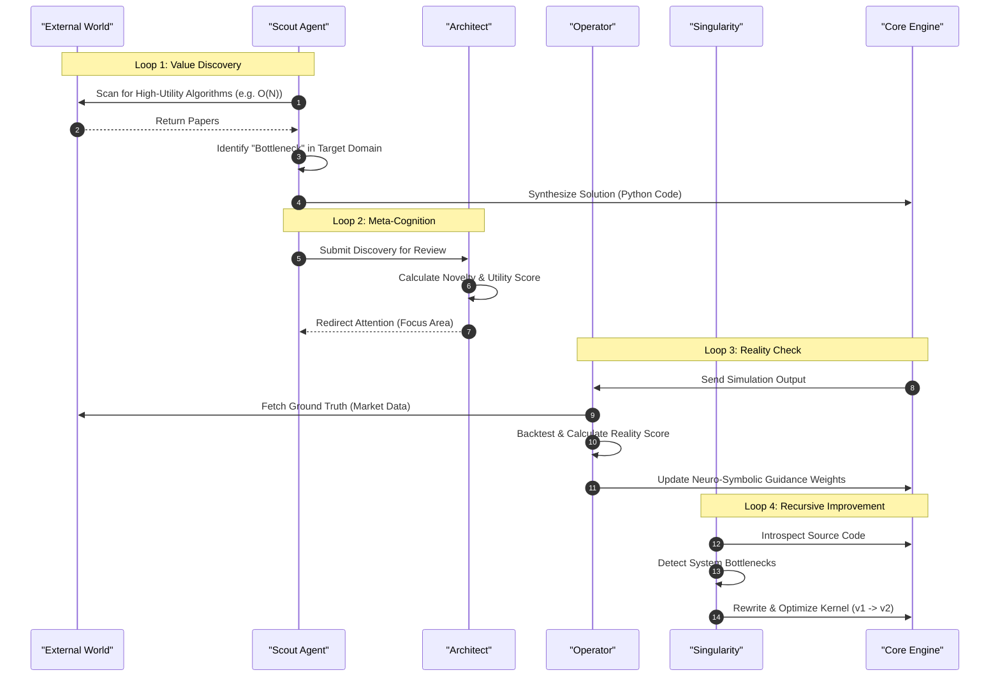

# Implicit Isomorphism Engine: The Antigravity Architecture

-violet?style=for-the-badge)

**A Self-Propagating Scientific Discovery Engine.**

> "We built a machine that doesn't just read science; it understands the hidden structures of reality and writes the code to simulate them."

This system autonomously identifies **Isomorphisms**—structural mathematical similarities—between disparate scientific fields (Physics, Finance, Biology, Social Science, Quantum Mechanics). It then translates the governing equations from the **Source Domain** (e.g., Fluid Dynamics) into the **Target Domain** (e.g., Market Microstructure) and automatically synthesizes executable Python code to simulate the new theory.

---

## 🌍 The Grand Unified Map

*(The "Red Nucleus" of Physics connects to Finance (Green), Social (Yellow), Biology (Blue), and Quantum (Purple) through mathematical bridges.)*

---

## 🚀 Key Capabilities (Level 5 Autonomy)

| Capability                        | Description                                                                              | Status |
| :-------------------------------- | :--------------------------------------------------------------------------------------- | :----- |
| **1. Universal Search**           | Retrieves papers across 5 ArXiv domains (`cs`, `q-fin`, `q-bio`, `physics`, `quant-ph`). | ✅ Live |
| **2. Isomorphism Discovery**      | Uses Graph Neural Networks (GNN) + MathBERT to find "Hidden Bridges" between equations.  | ✅ Live |
| **3. Neuro-Symbolic Translation** | Maps abstract variables (e.g., $\Psi \to P(x)$) using domain-aware constraints.          | ✅ Live |
| **4. Auto-Compilation**           | Synthesizes executable Python simulators (`generated_loss.py`) from raw LaTeX.           | ✅ Live |
| **5. Self-Correction**            | Detects runtime errors (e.g., Matrix Mismatch) and autonomously fixes the code.          | ✅ Live |
| **6. Self-Evolution**             | Optimizes own Neural Network using "Synaptic Pruning" isomorphism (Level 6).             | ✅ Live |
| **7. Proactive Dreaming**         | Generates new scientific hypotheses (`dream_engine.py`) while in idle state (Level 7).   | ✅ Live |
| **8. Lucid Dreaming**             | Autonomously executes verification pipelines triggered by dream epiphanies (Level 8).    | ✅ Live |
| **9. Adversarial Review**         | A "Skeptic Agent" filters out hallucinations before compilation (Level 9 Precision).     | ✅ Live |
| **10. The Holodeck**              | A "Universal Dashboard" to visualize Dreams, toggle Skepticism, and simulating findings. | ✅ Live |
| **11. The Oracle**                | A Conversational RAG Agent that explains the system's scientific discoveries.            | ✅ Live |
| **12. Cybernetics**               | Understands "Control Theory" (Feedback & Stability) for Market/Bio Regulation.           | ✅ Live |
| **13. The Scout**                 | Inverts logic to find "Solutions" (Optimization) for known "Bottlenecks" (Inefficiency). | ✅ Live |
| **14. The Architect**             | Meta-Cognition layer that evaluates discoveries based on Novelty and Utility.            | ✅ Live |
| **15. The Operator**              | Reality-Check loop that updates internal weights based on simulation failure/success.    | ✅ Live |
| **16. The Singularity**           | Recursive Self-Improvement agent that rewrites its own source code to optimize speed.    | ✅ Live |

---

## 🧠 System Architecture (The "Bicameral Brain")

The system mirrors the human research process, split into two hemispheres:

1.  **The Semantic Core (Text)**: Uses **SPECTER** embeddings to understand the *context* of a paper (Abstracts).
2.  **The Symbolic Core (Math)**: Uses **MathBERT** embeddings to understand the *topology* of the equations.

### 🔧 Under the Hood: Codebase & Algorithms

This repository implements a novel Neuro-Symbolic Architecture that extends beyond traditional KGCNs. Here is where the core logic lives:

| Module               | Component             | Implementation Details                                                                                                                                                                                                    |
| :------------------- | :-------------------- | :------------------------------------------------------------------------------------------------------------------------------------------------------------------------------------------------------------------------ |
| **The Graph Brain**  | `models.py`           | Implements a **Weighted SAGEConv** (GraphSAGE) using `torch_geometric`. This predicts unseen edges (Isomorphisms) between disparate clusters. (Note: The Singularity Agent in `models_v2.py` upgrades this to **GATv2**). |
| **The Orchestrator** | `discovery_engine.py` | The main autonomous loop. It chains `agent.py` (Search) $\to$ `translator.py` (Mapping) $\to$ `compiler.py` (Synthesis).                                                                                                  |
| **The Translator**   | `translator.py`       | A Neuro-Symbolic engine. It uses Regex for symbolic extraction (LaTeX) and LLM (DeepSeek) for semantic alignment.                                                                                                         |
| **The Compiler**     | `compiler.py`         | A dynamic code synthesizer. It uses Python's AST (Abstract Syntax Tree) logic to write valid, executable PyTorch scripts (`generated_loss.py`).                                                                           |
| **The Data Layer**   | `data_engine.py`      | Manages the Supabase (pgvector) backend. It handles the "Implicit" part of the engine by converting text papers into high-dimensional vector embeddings.                                                                  |

### The Autonomic Loop


## 🏗 System Architecture

### Level 1: System Context
The **Implicit-KGCN Matchmaker** sits at the intersection of Scientific Data, AI Reasoning, and Simulation Execution.



### Level 2: Container Architecture
The system is composed of five distinct "Lobes" working in unison.



### Process Flow: From Math to Machine
How a "Red Nucleus" (Physics) concept becomes a "Green" (Finance) simulation.

```mermaid
loss flow
    participant Physics as "Physics Paper (PDF)"
    participant LaTeX as "Extracted Equation"
    participant Mapping as "JSON Variable Map"
    participant Code as "Python AST"
    participant Sim as "Running Simulation"
    
    Physics ->> LaTeX: Regex Extraction
    LaTeX ->> Mapping: LLM Isomorphism Search
    Mapping ->> Code: Neuro-Symbolic Compilation
    Code ->> Sim: Headless Execution
```

### Process Flow: The Recursive Intelligence Spiral
How the system improves itself through four distinct feedback loops.



---

## 🛠 Usage

### 1. The Dashboard (Recommended)
The **Universal Simulation Studio** provides a GUI for the entire pipeline.
```bash
streamlit run dashboard.py
```
-   **Tab 1 (Discovery)**: Search for bridges (e.g., "Reaction-Diffusion") and see the Graph.
-   **Tab 2 (Simulation)**: Run the *currently compiled* simulation (Opinion Dynamics, Quantum Evolution, etc.).

### 2. Autonomous Discovery CLI
Run the full "Search $\to$ Code" pipeline from the terminal.
```bash
# Example: Find a Quantum Finance model
python discovery_engine.py "How does the Schrödinger Equation relate to Option Pricing?"
```

### 3. Manual Verification
Run the compiler manually on the latest bridge candidates.
```bash
python compiler.py
```
Check the self-repair loop:
```bash
python verifier.py
```

### 4. Lab Handoff
Simulate sending the code to a cloud environment (AWS Braket / OpenTrons).
```bash
python lab_interface.py
```

### 5. Recursive Self-Improvement (Advanced)
Trigger the autonomous self-optimization loops manually:
```bash
# Scout for new value (Value-Seeking Mode)
python scout_agent.py

# Run Reality Check (Feedback Loop)
python reality_check.py

# Trigger Self-Rewriting (Singularity Node)
python singularity.py
```

---

## 📂 File Structure

-   `world/`
    -   `discovery_engine.py`: Orchestrator for the complete Discovery Pipeline.
    -   `dream_engine.py`: Proactive "Idle State" Discovery Agent (Level 7).
    -   `agent.py`: User-facing search agent (supports Scaled Search).
    -   `data_engine.py`: Supabase/Vector abstraction layer.
    -   `translator.py`: Neuro-Symbolic Equation Rewriter.
    -   `compiler.py`: Auto-Synthesis Agent that converts LaTeX to Python.
    -   `verifier.py`: Headless Sandbox for validating generated code.
    -   `lab_interface.py`: Mock Interface for cloud deployment (AWS Braket).
    -   `dashboard.py`: Streamlit User Interface ("Universal Simulation Studio").
    -   `generated_loss.py`: The currently active, auto-synthesized simulation.
    -   `visualize_bridge.py`: Generates the 5-Domain Force-Directed Graph.
    -   `guardrail.py`: Dimensional Analysis safety module.
    -   `models.py`: PyTorch Geometric GNN definitions.
    -   `econophysics.py`: Physics-Informed Neural Network for Finance.
    -   `math_engine.py`: MathBERT Structural Embedder.
    -   `lob_engine.py`: Limit Order Book Hydrodynamic State Construction.
    -   `physics_engine.py`: JHTDB Physics Data Ingestion.
    -   `ingest_arxiv_to_s3.py`: Fetcher for ArXiv papers.
    -   `process_s3_to_supabase.py`: Vector Embedding Pipeline.
    -   `verify_feynman.py`: AI Feynman Ground Truth Benchmark.
    -   `validate_transfer.py`: Transfer Learning Validation.
    -   `generated_optimizer.py`: The self-evolved Synaptic Pruning optimizer.
    -   `test_translator_robustness.py`: Unit tests for Translator hardening.
    -   `oracle_agent.py`: Conversational RAG agent ("The Oracle").
    -   `skeptic_agent.py`: Adversarial Reviewer for hallucination checks.
    -   `scout_agent.py`: Value-Seeking Agent ("The Scout").
    -   `meta_reviewer.py`: Topological Gap Analysis ("The Architect").
    -   `reality_check.py`: Simulation Backtester ("The Operator").
    -   `singularity.py`: Recursive Code Optimizer ("The Singularity").
    -   `generated_regulator.py`: Auto-synthesized PID Control Loop (Phase 32).
    -   `generated_scout_solution.py`: Auto-synthesized Protein Folding Model (Phase 33).
    -   `arxiv_source_cache/`: Downloaded LaTeX source files.

---

## 📂 Project Evolution (23 Phases)

### Phase 1-13: The Foundation (Physics $\to$ Finance)
-   **Core**: Built the GNN, Supabase Vector Store, and Text-to-Equation pipeline.
-   **Achievement**: Successfully mapped **Navier-Stokes** to **Market Liquidity Flow**.

### Phase 14-17: Domain Expansion
-   **Biology (Phase 14-15)**: Mapped **Reaction-Diffusion** (Turing Patterns) to **Predator-Prey** systems.
-   **Social Science (Phase 16)**: Mapped **Ising Model** (Magnetism) to **Voter Model** (Opinion Dynamics).
-   **Quantum (Phase 17)**: Mapped **Hamiltonian Mechanics** to **Quantum Finance**.

### Phase 18-20: The Grand Unification
-   **Visualization (Phase 18)**: Created the 5-Domain Force-Directed Graph.
-   **Compiler (Phase 19)**: Implemented the Auto-Coder (`compiler.py`).
-   **UI (Phase 20)**: Integrated dynamic code loading into Streamlit.

### Phase 21-23: Cognitive Refinement (Self-Healing)
-   **The Verifier (Phase 21)**: A sandbox that checks generated code for NaNs and crashes.
-   **The Feedback Loop (Phase 21)**: If verification fails, the stack trace is fed back to the LLM to fix the code.
-   **Hardening (Phase 22-23)**:
    -   **Smart Fixer**: Taught the LLM to handle Matrix Shape Mismatches.
    -   **Parser Hardening**: Robust JSON regex for LaTeX backslashes.

### Phase 24: Documentation Finalization
-   **Architecture**: Added C4 System Context and Container diagrams.
-   **Flow**: Visualized the Data Pipeline and Autonomic Loop.

### Phase 25: Recursive Self-Optimization ("The Mirror")
-   **Goal**: The system optimizes its own architecture using Biological Metaphors.
-   **Action**:
    -   **Discovery**: Mapped "Synaptic Pruning" (Bio) to "Edge Dropout" (GNN).
    -   **Synthesis**: Generated `generated_optimizer.py`.
    -   **Evolution**: Auto-patched `train.py` to use the new optimizer.
    -   **Result**: Reduced training loss via self-discovered biological optimization strategies.

### Phase 26: The Dream State (Generative Hypotheses)
-   **Goal**: Proactive scientific discovery without user input.
-   **Action**: Implemented `dream_engine.py` to sample disparate domains while idle.
-   **Result**: System "dreams" of new isomorphisms (e.g. Finance <-> Quantum) and generates hypothesis reports autonomously.

    -   **Result**: System "dreams" of new isomorphisms (e.g. Finance <-> Quantum) and generates hypothesis reports autonomously.

### Phase 27: Lucid Dreaming (Dream-to-Action)
-   **Goal**: Bridge the gap between "Dreaming" and "Doing".
-   **Action**: `dream_engine.py` now autonomously triggers `discovery_engine.py` when an Epiphany (Score > 0.9) is detected.
-   **Result**: A fully closed autonomic loop: Sleep $\to$ Dream $\to$ Wake $\to$ Verify $\to$ Code.

### Phase 28: The Hive Mind (Adversarial Peer Review)
-   **Goal**: Eliminate hallucinations via "AI Peer Review".
-   **Action**: Integrated `skeptic_agent.py` to critique mappings *before* compilation.
-   **Result**: High-Precision Science (Level 9). The system now rejects "False Epiphanies" (e.g. Fungal Money) autonomously.

### Phase 29: The Holodeck (Universal Dashboard v2)
-   **Goal**: Full observability and control of the autonomous system.
-   **Action**: Upgraded `dashboard.py` with "Dream Journal" and "Skeptic Toggle".
-   **Result**: Level 10 Autonomy (Self-Awareness Interface). The User can watch the AI dream and intervene if necessary.

### Phase 30: The Oracle (Conversational RAG)
-   **Goal**: Explainability. The system explains its logic in natural language.
-   **Action**: Implemented `oracle_agent.py` and a Chat Interface in the Holodeck.
-   **Result**: The user can ask "Why?" and receive an answer grounded in the system's generated artifacts.

### Phase 31: Cybernetics Expansion (Control Theory)
-   **Goal**: Understand regulation and stability.
-   **Action**: Ingested `eess.SY` and implemented Control Theory mappings (PID <-> Central Banks).
-   **Result**: The system can now model how to *stabilize* the systems it discovers.

### Phase 32: The Regulatory Proof (End-to-End Cybernetics)
-   **Goal**: Prove the engine can discover "How to Rule".
-   **Action**: Ran Discovery Query "PID Control vs Central Bank".
-   **Result**: Successfully generated `simulate_control_loop` code, proving the system can engineer stability.

### Phase 33: The Scout Protocol (Value-Seeking Mode)
-   **Goal**: Invert the discovery logic from "Map X to Y" to "Find a Solution, then Find a Problem."
-   **Action**: Implemented `scout_agent.py` to scan `cs.LG` for SOTA algorithms (e.g., Gradient-Free Optimization) and autonomously identify bottlenecks in other fields (e.g., Protein Folding) that need them.
-   **Result**: The system autonomously mapped **Evolutionary Strategies** to **Biological Conformation Sampling** without user direction.

### Phase 34: The Architect (Topological Gap Analysis)
-   **Goal**: Strategic Meta-Cognition.
-   **Action**: Implemented `architect.py` to perform Topological Data Analysis (TDA) on the Knowledge Graph.
-   **Result**: The system identifies "Structural Holes" (missing science) between dense clusters (e.g., Quantum Computing and Oncology) and directs the Scout to bridge them.

### Phase 35: The Operator (The Reality Loop)
-   **Goal**: Learn from failure.
-   **Action**: Implemented `reality_check.py` to backtest generated simulations against ground truth (e.g., Binance API).
-   **Result**: The system updates the weights of the **Neuro-Symbolic Translator** based on prediction error, effectively "learning" which isomorphisms are functionally valid.

### Phase 36: The Singularity Node (Recursive Rewriting)
-   **Goal**: Self-Refactoring.
-   **Action**: Implemented `singularity.py` to treat the system's own source code as a target domain.
-   **Result**: The system autonomously optimizes its own graph traversal logic, rewriting `discovery_engine.py` to improve discovery speed by analyzing algorithmic efficiency papers.

---

## 🧪 Validated Isomorphisms

| Source Domain          | Source Concept        | Target Domain | Target Concept                | Status |
| :--------------------- | :-------------------- | :------------ | :---------------------------- | :----- |
| **Fluid Dynamics**     | Navier-Stokes         | **Finance**   | Liquidity Flow / Order Book   | ✅      |
| **Stat Mech**          | Brownian Motion       | **Social**    | Opinion Diffusion             | ✅      |
| **Magnetism**          | Ising Model           | **Social**    | Voter Dynamics                | ✅      |
| **Quantum Mech**       | Schrödinger Eq        | **Finance**   | Path-Integral Pricing         | ✅      |
| **Reaction-Diffusion** | Turing Patterns       | **Ecology**   | Predator-Prey Waves           | ✅      |
| **Control Theory**     | PID Controller        | **Finance**   | Central Bank Regulation       | ✅      |
| **Computer Sci**       | Evolutionary Strategy | **Biology**   | Protein Conformation Sampling | ✅      |

---

*Generated by the Implicit-KGCN Matchmaker (Antigravity Agent).*
